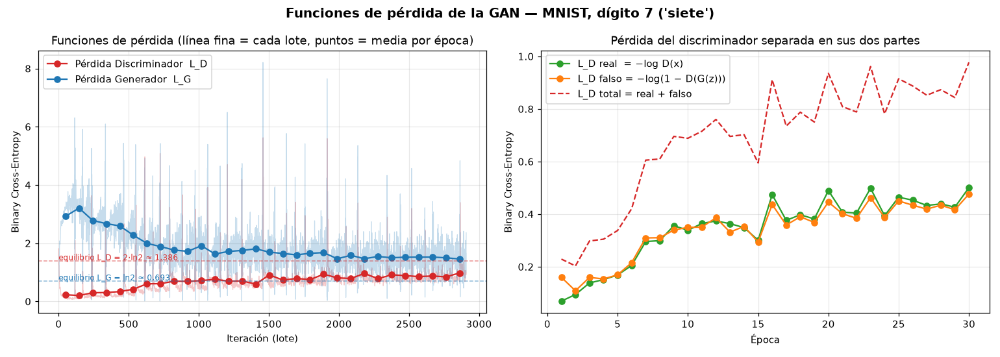
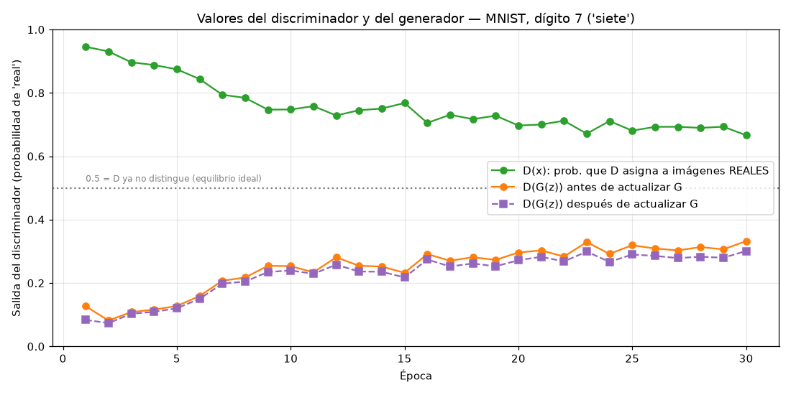
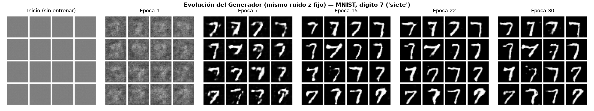
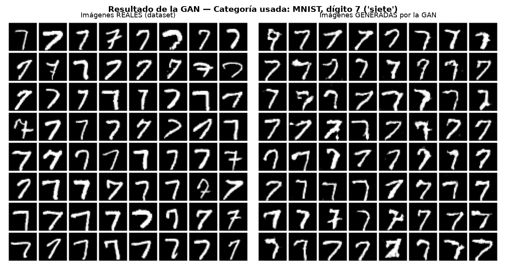
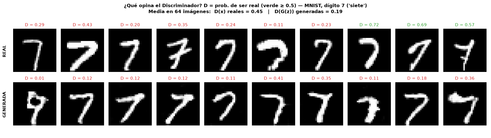
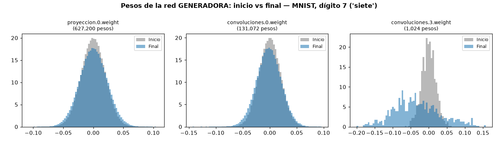
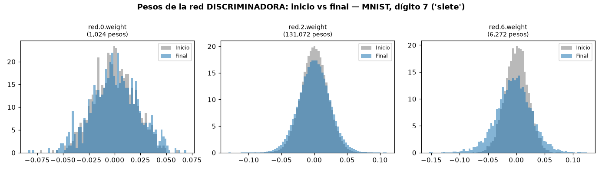

# GAN explicada — Generador vs Discriminador (MNIST, dígito 7)

Proyecto didáctico de una **Red Generativa Antagónica (GAN)** en PyTorch

## Daniel Jimenez, Juan Ortega, Andres Wilches ##

> **Categoría usada:** dataset **MNIST**, dígito **7 ("siete")** — 6.265 imágenes reales de entrenamiento.
> Se cambia en `config.py` (`CATEGORIA = 7`) o con `python entrenar.py --categoria 3`.

---

## 1. Cómo ejecutarlo

```bash
pip install -r requirements.txt
```

```bash
python entrenar.py
```

```bash
python generar.py
```

- `entrenar.py` descarga MNIST (la primera vez), entrena 30 épocas (~unos minutos en CPU) y guarda todo en `resultados/`.
- `generar.py` carga el generador entrenado y crea imágenes nuevas en `resultados/nuevas.png`.
- `python modelos.py` solo imprime la estructura y los parámetros de las dos redes.

## 2. Estructura del proyecto

| Archivo | Qué contiene |
|---|---|
| `config.py` | Todos los hiperparámetros y la **categoría usada** |
| `modelos.py` | **Dónde se definen las redes**: `class Generador` y `class Discriminador` |
| `datos.py` | Carga MNIST y filtra solo la categoría elegida |
| `entrenar.py` | **Dónde se crean (instancian) las redes**, la función de pérdida y el bucle de entrenamiento |
| `visualizar.py` | Gráficas de pérdidas, valores de D, evolución y resultado |
| `generar.py` | Usa el generador entrenado para crear imágenes nuevas |

Dónde se crea cada red neuronal:

- Definición de la **red Generadora** → `modelos.py`, `class Generador`
- Definición de la **red Discriminadora** → `modelos.py`, `class Discriminador`
- Creación (instancia) de G → `entrenar.py`, bloque marcado `>>> AQUÍ SE CREA LA RED NEURONAL GENERADORA (G) <<<`
- Creación (instancia) de D → `entrenar.py`, bloque marcado `>>> AQUÍ SE CREA LA RED NEURONAL DISCRIMINADORA (D) <<<`

## 3. ¿Qué es una GAN?

Dos redes que compiten:

- **Generador (G):** recibe ruido aleatorio `z` y dibuja una imagen falsa `G(z)`. Quiere **engañar** a D.
- **Discriminador (D):** recibe una imagen y devuelve la probabilidad de que sea **real**. Quiere **no ser engañado**.

```
ruido z (100) ──► [ GENERADOR ] ──► imagen falsa ──┐
                                                   ├──► [ DISCRIMINADOR ] ──► P(real) ∈ [0,1]
         imagen real del dígito 7 (MNIST) ─────────┘
```

Al principio G dibuja manchas y D las detecta fácilmente. Con el entrenamiento G mejora hasta que sus "7" se parecen a los reales.

## 4. Parámetros de la red neuronal GENERADORA (G)

Entrada: vector de ruido `z` de 100 valores ~ N(0,1). Salida: imagen 1×28×28 con píxeles en [-1, 1].

| Capa | Tipo | Salida | Parámetros | Para qué sirve |
|---|---|---|---:|---|
| proyeccion.0 | Linear(100 → 6272) | 6272 | 627.200 | Expande el ruido a 128 mapas de 7×7 |
| proyeccion.1 | BatchNorm1d | 6272 | 12.544 | Normaliza → entrenamiento estable |
| proyeccion.2 | ReLU | 6272 | 0 | No linealidad |
| *(reshape)* | — | 128×7×7 | 0 | Convierte el vector en "imagen" pequeña |
| convoluciones.0 | ConvTranspose2d(128→64, k4, s2, p1) | 64×14×14 | 131.072 | Duplica el tamaño |
| convoluciones.1 | BatchNorm2d | 64×14×14 | 128 | Normaliza |
| convoluciones.2 | ReLU | 64×14×14 | 0 | No linealidad |
| convoluciones.3 | ConvTranspose2d(64→1, k4, s2, p1) | 1×28×28 | 1.024 | Produce la imagen final |
| convoluciones.4 | Tanh | 1×28×28 | 0 | Píxeles en [-1, 1] |
| **Total** | | | **771.968** | |

Hiperparámetros de G (`config.py`): `DIM_LATENTE = 100`, `FILTROS_G = 64`, `LR_G = 0.0002`, Adam con `betas = (0.5, 0.999)`.

## 5. Parámetros de la red neuronal DISCRIMINADORA (D)

Entrada: imagen 1×28×28 (real o falsa). Salida: 1 número en [0, 1] = probabilidad de ser real.

| Capa | Tipo | Salida | Parámetros | Para qué sirve |
|---|---|---|---:|---|
| red.0 | Conv2d(1→64, k4, s2, p1) | 64×14×14 | 1.024 | Detecta trazos básicos, reduce a la mitad |
| red.1 | LeakyReLU(0.2) | 64×14×14 | 0 | No linealidad que deja pasar algo de gradiente negativo |
| red.2 | Conv2d(64→128, k4, s2, p1) | 128×7×7 | 131.072 | Detecta formas más complejas |
| red.3 | BatchNorm2d | 128×7×7 | 256 | Normaliza |
| red.4 | LeakyReLU(0.2) | 128×7×7 | 0 | No linealidad |
| red.5 | Flatten | 6272 | 0 | Aplana a vector |
| red.6 | Linear(6272 → 1) | 1 | 6.273 | Decisión final |
| red.7 | Sigmoid | 1 | 0 | Convierte a probabilidad |
| **Total** | | | **138.625** | |

Hiperparámetros de D: `FILTROS_D = 64`, `PENDIENTE_LEAKY = 0.2`, `LR_D = 0.0002`, Adam con `betas = (0.5, 0.999)`.

Los pesos de ambas redes se inicializan como recomienda el paper DCGAN: Normal(0, 0.02) en Conv/Linear y Normal(1, 0.02) en BatchNorm (`modelos.py → inicializar_pesos`).

## 6. Funciones de pérdida

Se usa **Binary Cross-Entropy** (`nn.BCELoss`):

```
BCE(p, y) = −[ y·log(p) + (1 − y)·log(1 − p) ]
```

**Pérdida del Discriminador** — quiere `D(x) → 1` (reales) y `D(G(z)) → 0` (falsas):

```
L_D = BCE(D(x), 1) + BCE(D(G(z)), 0)
    = −log D(x)  −  log(1 − D(G(z)))
       └ parte real ┘  └── parte falsa ──┘
```

**Pérdida del Generador** (versión "no saturante") — quiere `D(G(z)) → 1`:

```
L_G = BCE(D(G(z)), 1) = −log D(G(z))
```

Truco clave: para entrenar G se usan las imágenes falsas **con etiqueta de "real"**. Así G recibe gradiente que le dice cómo cambiar para que D se equivoque.

**Equilibrio teórico:** si D ya no distingue, `D(x) = D(G(z)) = 0.5`, entonces `L_D = 2·ln 2 ≈ 1,386` y `L_G = ln 2 ≈ 0,693`. En la práctica los valores oscilan alrededor de ahí; **en una GAN la pérdida no baja a cero** como en una red normal, porque las dos redes compiten.

En cada lote se hace:

1. **Paso del Discriminador:** `L_D` con reales (etiqueta 1) + falsas con `.detach()` (etiqueta 0) → actualiza solo D.
2. **Paso del Generador:** pasa las falsas por D con etiqueta 1 → `L_G` → actualiza solo G.

## 7. Valores del generador y del discriminador

Durante el entrenamiento se imprime y guarda (en `resultados/historial.csv`) por época:

| Valor | Significado | Valor ideal |
|---|---|---|
| `Loss_D` | Pérdida total de D (real + falso) | ~1,386 |
| `Loss_D_real` | `−log D(x)`: qué tan bien reconoce reales | — |
| `Loss_D_falso` | `−log(1 − D(G(z)))`: qué tan bien detecta falsas | — |
| `Loss_G` | `−log D(G(z))`: qué tan bien G engaña a D | ~0,693 |
| `D(x)` | Probabilidad media que D da a imágenes **reales** | → 0,5 |
| `D(G(z))` antes | Probabilidad que D da a las falsas antes de actualizar G | → 0,5 |
| `D(G(z))` después | La misma tras actualizar D (la que usa G para aprender) | → 0,5 |

Cómo leerlo: si `D(x) ≈ 1` y `D(G(z)) ≈ 0`, D está ganando con claridad (G todavía es malo). Si ambos se acercan a 0,5, G produce imágenes que D no sabe distinguir.

Además se guardan los **valores de los pesos** de cada capa (media, desviación, mínimo y máximo, al inicio y al final) en `resultados/parametros_redes.txt` y sus histogramas en `pesos_generador.png` y `pesos_discriminador.png`.

## 8. Resultados obtenidos (30 épocas, CPU, ~3,5 min)

**Categoría usada: MNIST, dígito 7 ("siete") — 6.265 imágenes reales.**

### 8.1 Valores por época (extracto de `resultados/historial.csv`)

| Época | Loss_D | Loss_D real | Loss_D falso | Loss_G | D(x) | D(G(z)) antes → después |
|---:|---:|---:|---:|---:|---:|---|
| 1 | 0,229 | 0,069 | 0,160 | 2,922 | 0,946 | 0,127 → 0,084 |
| 5 | 0,338 | 0,169 | 0,169 | 2,593 | 0,874 | 0,128 → 0,120 |
| 10 | 0,689 | 0,339 | 0,350 | 1,722 | 0,748 | 0,253 → 0,240 |
| 15 | 0,595 | 0,301 | 0,294 | 1,806 | 0,768 | 0,232 → 0,218 |
| 20 | 0,936 | 0,490 | 0,446 | 1,677 | 0,697 | 0,296 → 0,272 |
| 25 | 0,915 | 0,465 | 0,450 | 1,501 | 0,681 | 0,319 → 0,290 |
| 30 | 0,977 | 0,501 | 0,476 | 1,459 | 0,666 | 0,332 → 0,301 |

Interpretación:

- **Época 1:** D gana claramente (`D(x) = 0,95`, `D(G(z)) = 0,13`). G todavía dibuja ruido, por eso `Loss_G` es alta (2,9).
- **Épocas 1 → 30:** `Loss_D` sube y `Loss_G` baja: G mejora y a D le cuesta cada vez más distinguir. `D(x)` baja de 0,95 a 0,67 y `D(G(z))` sube de 0,13 a 0,33; ambos se acercan a 0,5.
- **Época 30:** todavía no hay equilibrio perfecto (`L_D = 0,98` frente al ideal 1,39); con más épocas los valores seguirían acercándose. Eso es normal en una GAN.

### 8.2 Funciones de pérdida



### 8.3 Valores del discriminador D(x) y D(G(z))



### 8.4 Evolución del generador (mismo ruido z en todas las épocas)



Al inicio G produce gris uniforme (sus pesos son casi cero), en la época 1 ruido, en la época 7 ya aparecen "7" y luego se van afinando. Las 30 cuadrículas completas están en `resultados/evolucion/`.

### 8.5 Resultado final de la GAN — dígito 7



### 8.6 Veredicto del discriminador imagen por imagen



Sobre 64 imágenes, D da de media **0,45 a los 7 reales** y **0,19 a los 7 generados**: todavía los distingue, pero ya duda mucho (al principio daba 0,95 frente a 0,13). Imagen por imagen hay ruido: algunos 7 reales raros reciben valores bajos y algunos generados llegan a 0,41.

Nota técnica: para esta figura se evalúa una copia de D en modo `train()`, para que BatchNorm use las estadísticas del lote igual que durante el entrenamiento. Con `D.eval()` los valores salen distorsionados.

### 8.7 Valores de los pesos: inicio vs final





Las capas grandes (627.200 y 131.072 pesos) cambian poco en forma; la capa final del generador (`convoluciones.3`, la que "pinta" los píxeles) se ensancha mucho: es donde más aprendió. Las estadísticas exactas (media, desviación, mín, máx por capa) están en `resultados/parametros_redes.txt`.

## 9. Archivos que genera el entrenamiento (`resultados/`)

| Archivo | Contenido |
|---|---|
| `parametros_redes.txt` | Arquitectura, parámetros por capa y estadísticas de pesos de G y D (inicio y final) |
| `historial.csv` | Loss_D, Loss_D real/falso, Loss_G, D(x), D(G(z)) por época |
| `resumen.json` | Resumen: categoría, nº de parámetros, valores finales |
| `perdidas.png` | Funciones de pérdida |
| `valores_discriminador.png` | D(x) y D(G(z)) por época |
| `evolucion_generador.png` + `evolucion/` | Cómo mejora G época a época |
| `resultado_final.png` | Reales vs generadas (con la categoría en el título) |
| `generadas_final.png` | 64 dígitos 7 generados |
| `veredicto_discriminador.png` | Probabilidad que D asigna a cada imagen |
| `pesos_generador.png`, `pesos_discriminador.png` | Histogramas de pesos |
| `modelos/generador.pt`, `modelos/discriminador.pt` | Redes entrenadas |
| `nuevas.png` | Imágenes nuevas creadas con `generar.py` |

El registro completo de la consola del entrenamiento queda en `entrenamiento_log.txt`.

## 10. Ideas para experimentar

- Cambiar la categoría: `python entrenar.py --categoria 3`
- Más épocas para acercarse al equilibrio: `python entrenar.py --epocas 60`
- Cambiar `DIM_LATENTE`, `FILTROS_G`, `FILTROS_D` o las tasas de aprendizaje en `config.py` y comparar las gráficas.

## 11. Requisitos del sistema

Para ejecutar el proyecto se necesita un entorno de Python con las siguientes bibliotecas:

- **PyTorch (`torch`):** construcción y entrenamiento de las redes neuronales.
- **Torchvision (`torchvision`):** acceso al conjunto de datos MNIST.
- **Matplotlib (`matplotlib`):** generación de gráficas y visualizaciones.
- **NumPy (`numpy`):** operaciones numéricas.

Las dependencias se encuentran definidas en `requirements.txt`. Se recomienda utilizar un entorno virtual para mantener aisladas las bibliotecas del proyecto.

### Preparación del entorno

```bash
python -m venv .venv
```

En Windows:

```bash
.venv\Scripts\activate
```

En Linux o macOS:

```bash
source .venv/bin/activate
```

Instala las dependencias:

```bash
python -m pip install -r requirements.txt
```

Para comprobar la instalación de PyTorch:

```bash
python -c "import torch; print(torch.__version__)"
```

## 12. Problemas frecuentes

### Error al descargar MNIST

El conjunto de datos puede requerir conexión a Internet durante la primera ejecución. Comprueba tu conexión y vuelve a ejecutar el entrenamiento.

### Error al instalar PyTorch

Verifica la versión de Python y consulta las instrucciones oficiales de instalación de PyTorch para seleccionar una versión compatible con tu sistema operativo y hardware.

### No se encuentra el modelo entrenado

Ejecuta primero el entrenamiento y comprueba que los archivos del generador se hayan guardado en la carpeta `resultados/` antes de ejecutar `generar.py`.

### Las imágenes generadas no parecen dígitos reconocibles

La calidad depende del entrenamiento y de los hiperparámetros. Prueba diferentes cantidades de épocas y compara las gráficas antes de concluir que el modelo ha mejorado.

## 13. Conceptos importantes en las GAN

- **Espacio latente:** espacio de vectores aleatorios que el generador transforma en imágenes.
- **Época:** recorrido completo por los datos de entrenamiento utilizados por el modelo.
- **Función de pérdida:** medida que permite evaluar el desempeño de cada red durante el entrenamiento.
- **Colapso de modos (*mode collapse*):** problema en el que el generador produce imágenes muy similares y pierde diversidad.
- **Equilibrio adversarial:** situación en la que el generador y el discriminador mejoran mediante sus objetivos contrapuestos.

## 14. Recursos de aprendizaje

Los siguientes recursos permiten profundizar en los fundamentos de las Redes Generativas Antagónicas (GAN), explorar su funcionamiento de manera interactiva y conocer diferentes conjuntos de datos para experimentar con modelos de aprendizaje automático.

### Documentación y tutoriales

- [Documentación oficial de PyTorch](https://pytorch.org/docs/stable/index.html)
- [Tutoriales oficiales de PyTorch](https://pytorch.org/tutorials/)
- [Documentación de Torchvision](https://pytorch.org/vision/stable/index.html)
- [Introducción a las GAN - Google Machine Learning](https://developers.google.com/machine-learning/gan?hl=es-419)

### Herramientas interactivas y experimentación

- [GAN Lab - Polo Club of Data Science](https://poloclub.github.io/ganlab/): herramienta interactiva para visualizar y comprender cómo funcionan las redes generativas antagónicas.
- [Quick, Draw! - Google](https://quickdraw.withgoogle.com/data): conjunto de datos de dibujos que puede utilizarse para explorar aplicaciones de aprendizaje automático y generación de imágenes.

### Investigación y fundamentos

- [Artículo original de las GAN](https://arxiv.org/abs/1406.2661)

Estos recursos permiten ampliar los conocimientos sobre redes neuronales, generación de imágenes, entrenamiento adversarial y procesamiento de datos, además de facilitar la realización de nuevos experimentos relacionados con el proyecto.
